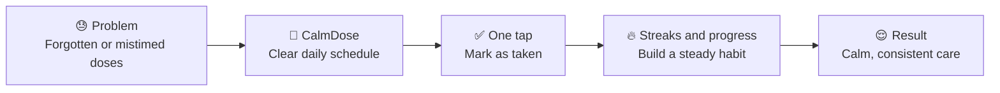

<div align="center">


<br/>

**A calm, all-ages healthcare website with a medicine reminder, claymorphism design and an animated 3D pill.**

<br/>


<br/>

[🌐 Live Demo](#) &nbsp;•&nbsp; [🐞 Report Bug](#) &nbsp;•&nbsp; [💡 Request Feature](#)

</div>

---

## 📑 Table of Contents

- [🎯 Main Motive](#-main-motive)
- [🧩 The Problem](#-the-problem)
- [💡 Our Solution](#-our-solution)
- [✨ Features](#-features)
- [🎨 Design Language](#-design-language)
- [🛠️ Tech Stack](#️-tech-stack)
- [🚀 Getting Started](#-getting-started)
- [📁 Project Structure](#-project-structure)
- [🔧 Customization](#-customization)
- [🔒 Privacy](#-privacy)
- [♿ Accessibility](#-accessibility)
- [🗺️ Roadmap](#️-roadmap)
- [⚠️ Disclaimer](#️-disclaimer)
- [👤 Author](#-author)

---

## 🎯 Main Motive

> **Make taking medicine feel calm, simple and stress-free for every person, at every age.**

CalmDose was built with one clear purpose: to turn a daily worry into a gentle daily habit.

| 🎯 Goal | What it means |
|---|---|
| **Simplicity** | A tool a teenager and a grandparent can both use without any instructions |
| **Consistency** | Help people build the habit of taking medicines on time, every day |
| **Calm** | A soft, friendly design that reduces anxiety instead of adding to it |
| **Trust** | Honest content, clear disclaimers and your data staying on your device |
| **Inclusion** | Readable text, big buttons and full keyboard support so nobody is left out |

---

## 🧩 The Problem

> **Millions of people miss or mistime their medicines, and it affects their health.**

Taking the right medicine at the right time sounds simple, but real life makes it hard. Busy adults forget doses between work and family. Seniors manage several medicines with different schedules. Parents track a child's treatment on top of everything else. Most reminder tools are too complicated, too cluttered, or not designed for people of every age.

When doses are missed or confused, recovery can slow down, treatment becomes less effective, and families carry extra stress.

### 👥 Who is affected

| 👨‍👩‍👧 Children and parents | 💼 Working adults | 👴 Seniors |
|---|---|---|
| Parents must remember schedules for someone else | Busy days make doses easy to forget | Often manage multiple medicines at different times |

### ⚠️ What goes wrong

- 😓 It is **easy to forget** a dose
- 🗂️ It is **hard to keep track** of several medicines and times
- 🧩 There is **no simple, friendly reminder** that everyone can use comfortably

---

## 💡 Our Solution

CalmDose is a simple, friendly health companion that removes the stress from taking medicines.



- 📅 A clear daily schedule that shows what to take and when
- ✅ One-tap "Mark as taken" with instant, encouraging feedback
- ⏳ A live countdown to the next dose and a daily progress ring
- 🔥 Streaks that reward consistency
- 🎨 A calm, readable design that feels comfortable for all ages
- 🔒 Privacy first: everything stays on your own device

---

## ✨ Features

### 💊 Medicine Reminder and Pill Tracker
- ➕ Add medicines with name, dose, time and shape (capsule, tablet, syrup)
- 📅 Today's schedule sorted by time, with status badges: upcoming, due now, taken
- ⏳ Live countdown to the next dose
- 🔵 Animated circular progress ring for today's completion
- 🔥 Streak counter with a celebration when all doses are taken
- ✏️ Edit and delete medicines, plus a "Reset demo data" button
- 💾 Data saved automatically in the browser

### 🩺 Daily Health Tools
- 💧 Daily water intake counter
- ⚖️ BMI calculator with an informational disclaimer
- 🔍 Searchable list of example doctors
- 📖 Short, plain-language health tips

### 🌀 3D and Motion
- Animated 3D capsules, tablets and a medicine bottle built with Three.js
- Mouse and touch parallax, scroll-linked movement and click-to-spin
- Smooth wave dividers, flowing line art and a scroll progress line
- The 3D scene reacts when you mark a dose as taken

### 🧭 Navigation
- Sticky navbar with active link highlighting
- Slide-in mobile menu with a smooth hamburger-to-close animation
- Dark and light mode, remembered between visits

---

## 🎨 Design Language

CalmDose uses **claymorphism**: soft, puffy, rounded surfaces that feel friendly and touchable, refined with a professional teal and navy accent so it never looks childish.

| Element | Style |
|---|---|
| 🧱 Surfaces | Very rounded corners, layered soft shadows, gentle inset depth |
| 🎨 Colors | Calm teal, soft blue, warm peach accent, pastel mint and lavender |
| 🔤 Fonts | Poppins for headings, Nunito for body text |
| 🌊 Flow | Curved wave dividers and gently drawing line art between sections |
| 🌙 Themes | Light mode and a softer dark clay mode |
| 🖱️ Buttons | Lift on hover, sink when pressed, clear focus ring |

---

## 🛠️ Tech Stack

| Area | Technology |
|---|---|
| 🏗️ Structure | HTML5 (semantic) |
| 🎨 Styling | CSS3 (custom properties, Grid, Flexbox, claymorphism shadows) |
| ⚙️ Logic | Vanilla JavaScript (ES modules) |
| 🧊 3D graphics | Three.js (CDN with an import map) |
| 💾 Storage | Browser localStorage |
| 🔤 Fonts | Google Fonts (Nunito, Poppins) |

> No frameworks. No build step. No backend.

---

## 🚀 Getting Started

CalmDose is a single self-contained file, so there is nothing to install.

### ▶️ Run locally

```bash
# 1. Clone the repository
git clone https://github.com/your-username/calmdose.git

# 2. Go into the folder
cd calmdose

# 3. Open index.html in your browser
```

If the 3D scene does not load because of browser module restrictions, run a small local server:

```bash
# Python
python -m http.server 8000

# or Node
npx serve
```

Then open `http://localhost:8000`.

### 🌍 Deploy

- **Netlify Drop:** drag the project folder onto the Netlify Drop page.
- **GitHub Pages:** push the repository, then go to Settings, Pages, and choose the main branch.

---

## 📁 Project Structure

```
calmdose/
├── 📄 index.html        # The complete website (HTML, CSS, JavaScript)
├── 📘 README.md         # Project documentation
└── 🖼️ screenshots/      # Images used in this README (optional)
```

---

## 🔧 Customization

<details>
<summary><b>Click to expand</b></summary>

<br/>

| I want to change... | Where to look |
|---|---|
| 🎨 Colors and theme | CSS variables at the top of the style section in `index.html` |
| ✍️ Text and content | The HTML sections |
| 💊 Sample medicines and doctors | The data arrays in the JavaScript section |
| 🧊 3D medicine look | The Three.js section (colors, sizes, animation speeds) |
| 👤 Creator details and links | The "Meet the Creator" card and the footer |

</details>

---

## 🖼️ Screenshots

> Add your screenshots after deploying.

| Hero with 3D medicine | Medicine tracker | Mobile menu |
|:---:|:---:|:---:|
| `screenshots/hero.png` | `screenshots/tracker.png` | `screenshots/mobile.png` |

---

## 🔒 Privacy

CalmDose does **not** collect, upload or share any personal data. All medicines, progress and settings are stored only in your own browser using localStorage. Clearing your browser data removes everything.

---

## ♿ Accessibility

- ✅ Semantic landmarks and a logical heading order
- ✅ High-contrast colors and large default text
- ✅ Full keyboard navigation with visible focus states
- ✅ ARIA labels, live regions for reminders and toasts, and a text alternative for the 3D canvas
- ✅ Reduced-motion support for animations

---

## 🗺️ Roadmap

- [ ] 📱 Mobile app version
- [ ] 👨‍👩‍👧 Caregiver alerts for family members
- [ ] 🌐 Multilingual support
- [ ] 🏥 Pharmacy integration
- [ ] ☁️ Optional account sync across devices

---

## ⚠️ Disclaimer

CalmDose is for informational and organizational purposes only. It is **not** a substitute for professional medical advice, diagnosis or treatment. Always follow your doctor's or pharmacist's instructions, and seek professional help for any medical concern. Doctor listings and health statistics shown in the demo are examples only.

---

## 👤 Author

<div align="center">

### Designed and built by **Kenedy Duwarah**

[](#)
[](#)

<br/>

If you like this project, please give it a ⭐

**Made with 💚 for calmer, healthier days.**

</div>
